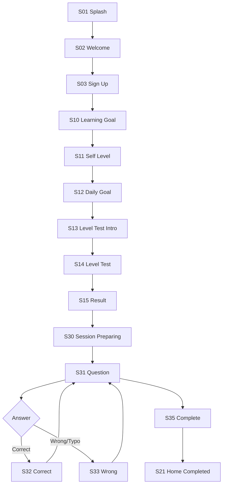
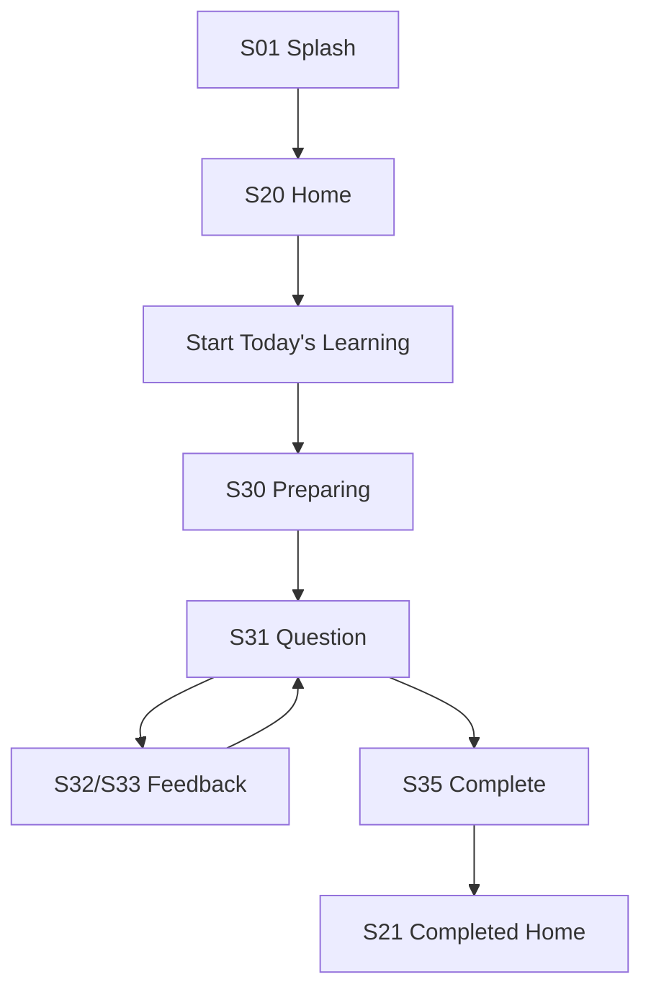

# IA & User Flow — Project LingoLoop

## 1. Navigation Principle

MVP의 사용자 선택을 최소화한다.

Bottom tabs:

```text
Home | Progress | Settings
```

핵심 학습은 Home의 Primary CTA에서 시작한다.

---

# 2. Screen Map

## Authentication

- `S01` Splash
- `S02` Welcome
- `S03` Sign Up
- `S04` Login

## Onboarding

- `S10` Learning Goal
- `S11` Self Level
- `S12` Daily Goal
- `S13` Level Test Intro
- `S14` Level Test Question
- `S15` Level Result

## Home

- `S20` Home
- `S21` Home — Goal Completed State

## Learning

- `S30` Session Preparing
- `S31` Vocabulary Question
- `S32` Correct Feedback
- `S33` Wrong/Typo Feedback
- `S34` Hint Sheet
- `S35` Session Complete
- `S36` Extra Learning Selector

## Progress

- `S40` Progress Overview
- `S41` Vocabulary Status
- `S42` Learning History

## Monetization

- `S50` Paywall
- `S51` Purchase Success
- `S52` Restore Purchase Result

## Settings

- `S60` Settings
- `S61` Account
- `S62` Daily Goal Setting
- `S63` Notifications
- `S64` Subscription
- `S65` Legal
- `S66` Delete Account

---

# 3. Route Map

```text
/
├ (auth)
│ ├ welcome
│ ├ signup
│ └ login
├ onboarding
│ ├ goal
│ ├ self-level
│ ├ daily-goal
│ ├ level-test-intro
│ ├ level-test
│ └ result
├ (tabs)
│ ├ home
│ ├ progress
│ └ settings
├ learn
│ ├ preparing
│ ├ :sessionId
│ ├ :sessionId/feedback
│ └ :sessionId/result
├ premium
│ ├ paywall
│ └ success
└ settings
  ├ account
  ├ daily-goal
  ├ notifications
  ├ subscription
  ├ legal
  └ delete-account
```

---

# 4. New User Flow



---

# 5. Returning User Flow



---

# 6. Splash Routing

```text
No token
→ S02

Token + onboarding incomplete
→ last incomplete onboarding screen

Token + onboarding complete
→ S20
```

---

# 7. Daily Session Flow

```text
POST /learning/sessions { type: daily }
↓
Server checks:
- subscription/free cap
- due reviews
- candidate new words
- difficulty fit
- priority
↓
Session created
↓
S31
```

---

# 8. Answer Loop

```text
S31 Question
↓
Submit
↓
Server transaction:
Attempt
Mastery
SRS
XP
Daily Progress
↓
Response
↓
S32 or S33
↓
Next
↓
S31 or S35
```

---

# 9. Hint Flow

```text
S31
↓
Hint tap
↓
S34 bottom sheet
↓
Hint level 1
↓
Optional level 2
↓
Return S31
```

---

# 10. Level Test Flow

Level Test는 일반 Daily Session과 `type=level_test`로 분리한다.

- XP 없음
- Streak 없음
- UserWordMastery에 강한 영구 신호로 직접 반영하지 않음
- 결과는 `skillLevel` 초기화에 사용

---

# 11. Progress Drilldown

```text
S40 Overview
├ tap Learned Words → S41
├ tap Mastered → S41 filter=mastered
├ tap Weak → S41 filter=weak
└ tap History → S42
```

---

# 12. Paywall Entry Points

- Free daily cap reached
- Weakness mode
- Detailed stats
- Extra learning beyond free limit
- Premium settings

Paywall를 학습 도중 갑자기 띄우지 않는다. 사용자의 마지막 제출 결과를 먼저 저장/표시한 뒤 자연스러운 경계에서 노출한다.

---

# 13. Purchase Flow

```text
S50
↓
RevenueCat purchase
↓
Store billing
↓
Entitlement active
↓
Backend webhook
↓
Subscription record sync
↓
S51
↓
Return to original intent
```

---

# 14. Error Navigation

## Auth expired
현재 route 저장 → Login → 성공 후 안전한 route로 복귀.

## Session unavailable
S20 + non-blocking message.

## Content missing
해당 question skip + telemetry.

## Purchase error
S50 유지 + retry.

---

# 15. Future Full Product IA

MVP 검증 후:

```text
Home
Learn
Conversation
Progress
Profile
```

`Learn`:

- Vocabulary
- Grammar
- Listening
- Pronunciation
- Expression

---

# 16. IA Rules

1. 핵심 학습까지 2 taps 이내.
2. 같은 정보의 진입점이 여러 개여도 destination은 동일해야 한다.
3. Progress는 “점수”보다 “무엇을 알고/모르는지”를 보여준다.
4. 학습 중 Bottom Tab을 숨겨 집중을 유지한다.
5. feedback은 full-page transition보다 같은 learning surface 안에서 상태 전환을 우선한다.
